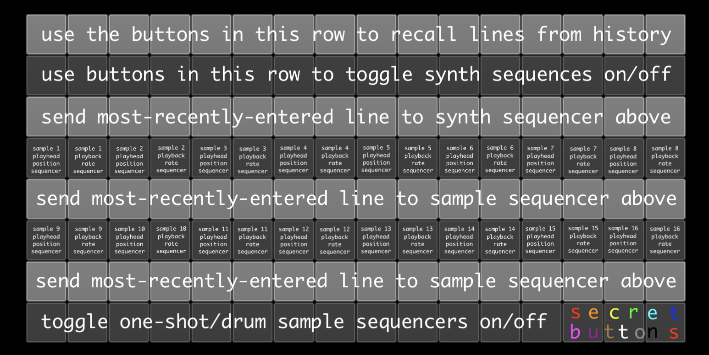

# schicksalslied 2.0

a poetry sequencer for monome norns

> "What is a poet? A poet is an unhappy being whose heart is torn by secret sufferings, but whose lips are so strangely formed that when the sighs and the cries escape them, they sound like beautiful music."
> — Søren Kierkegaard, *Either/Or*

type on a keyboard or pick a line from history, assign it to a grid cell, toggle the cell on. each character of the line becomes a stream of bytes that drive the cell's synthesis, sampling, MIDI, or crow output. different cells play different lines simultaneously at their own rates. fully operable from grid, params menu, or MIDI controller.

## install

copy this folder to `/home/we/dust/code/schicksalslied/` on your norns.

**reboot norns** so the `Lied` SuperCollider engine registers, then load using SELECT.

## hardware

- monome norns (any model)
- monome grid (optional — script is fully operable via PARAMETERS without one)
- USB keyboard (for text entry)
- optional: MIDI controller, crow, w/syn, w/del, w/tape, just friends

## the grid



```
1 ─ history: 128 typed/loaded lines
2 ─ voice cells × 16 (Sine, TriSin, Ringer, crow, JF, w/, MIDI, ...)
3 ─ assign row for row 2
4 ─ looping samplers 1–8 (odd cols = trigger, even = rate)
5 ─ assign row for row 4
6 ─ looping samplers 9–16 (odd cols = trigger, even = rate)
7 ─ assign row for row 6
8 ─ one-shots 1–12 (cols 1–12), granular freeze (13), mic→delay (14), granular out (15), mic monitor (16)
```

rows 2/4/6/8 are toggles — press to start/stop. rows 3/5/7 are momentary — press to assign the staged line to the cell above.

## hardware controls

```
K1: (preserves system back/menu)   E1: scroll history
K2: append history line             E2: global amp
K3: ENTER (stage + add to history)  E3: BPM
```

## voice roles

each of the 16 row-2 cells can be assigned one of 12 roles via PARAMETERS → synths → cell N → role.

- **Sine** — plain sine voice (the default)
- **TriSin** — FM voice (triangle carrier, sine modulator)
- **Ringer** — pinged resonant filter, percussive
- **crow 1+2** / **crow 3+4** — pitch CV + AR env on a pair of crow outputs
- **JF** / **JF run** / **JF quantize** — just friends via ii (synthesis, RUN, quantize)
- **w/syn** — w/syn over ii
- **w/del** — karplus-strong via w/del
- **w/tape looper** — w/tape loop choreography
- **MIDI** — note on/off to the configured device + channel

all 16 cells default to Sine. each cell also has a **hz offset** (±100 Hz, applied directly to the frequency) next to pitch offset — handy for slow beating between cells tuned to the same note.

## samplers and one-shots

load files via PARAMETERS → looping samplers → sampler N → file (10-minute max per file; a longer file is rejected and the slot goes silent, with a warning in maiden). identical files loaded into multiple slots share one buffer. mono files play centered in both speakers; stereo files keep their stereo image (one-shots and looping samplers alike).

sampler **trigger cells** (odd cols on rows 4/6) emit start + end positions per fire. **rate cells** (even cols, paired with the trigger to their left) set playback rate independently — negative for reverse, 0 for freeze.

one-shots (row 8 cols 1–12) can load either an **individual file** or a **folder of samples** (e.g. a kit of drum hits). `source` is the first setting of each one-shot slot; set it to `file` or `folder`:
- **folder**: pick any file inside the folder you want and the whole folder loads (sorted by name; up to 128 files / 10 minutes of audio in total — extras are skipped). picking another file in the same folder doesn't reload it; to pick up files you added, switch `source` to `file` and back.
- **`sample select`**: sequence through the folder (`seq`), pick randomly on every hit (`random`), or choose from the cell's text (`lied`).
- **`accent mode`**: `off`, `pattern` (accent steps of an up-to-8-step groove, to keep a consistent rhythm even when firing random drum samples), or `lied` (uppercase letters in the text accent the hit).

every one-shot hit reads 3 characters of its cell's text (rate, sample, accent) whatever the modes, so switching `lied` accents or sample select never changes the rhythm.

## granular delay

row 8 col 13 toggles granular freeze (not saved in PSETs). col 14 toggles mic into the delay buffer. col 15 toggles granular output.

any voice can route into the granular chain via its `granular send` param. turn up `feedback amp` (PARAMETERS → granular delay → feedback patch) to make the chain self-modulating.

PARAMETERS → granular delay → granular engine:
- **granular freeze** — stop writing new audio; the grains keep playing what's in the buffer.
- **buffer preservation** — how much of the old buffer is kept as new audio is recorded (0 = overwrite, 1 = keep; the recirculated signal is soft-clipped so it can't grow without bound).
- **grain window** — grain envelope: hann, percussive, swell, reverse swell.
- **grain sync distribution** — 0 to 1, how grain triggers are timed: 1 = regular, synchronized pulses, 0 = random (dust-like) scatter, in between mixes the two.
- **grain cutoff ceiling** — upper limit (200–16000 Hz) for the per-grain filter cutoffs.
- **grain rate mult** — global multiplier (0.25–4x) on every grain's playback rate.
- **grain octaves / fifths & 4ths / sub-octaves** — switch the grains' playback rates to sets that include those intervals (octave up, fifth/fourth, one or two octaves down).
- **grain reverse** — every other grain plays backwards.

## mic monitor (row 8 col 16)

col 16 is a shortcut to the norns LEVELS `monitor_level` (the hardware input monitor), so it isn't part of the feedback patch. the LED is lit when the monitor is audible. pressing it when lit mutes the monitor and remembers the level; pressing it when dark unmutes to the level it had when you muted it (or -12 dB if there's none remembered). panic mutes it too. leaving the script does not touch the level — like any LEVELS change, it stays where you left it.

## sequencer modes

every cell's rate is determined by its **seq mode** (PARAMETERS → … → cell N → seq mode):

- **lied** — rate derived from the cell's text bytes (`byte / byte × scale`)
- **fixed** — a constant musical fraction (1/16 through 64 beats)
- **seq** — cycle through 1-8 user-defined step durations
- **random** — random fraction in a configurable range

sampler position/duration and rate cells each have parallel **value modes** with the same four options.

## master FX

PARAMETERS → master fx: delay (sync'd or free, up to 8 sec), reverb (room + damp + amp), per-voice send levels per cell. delay routes to both dry and reverb at independent send levels.

## MIDI

PARAMETERS → midi input: pick device + role (TriSin or Ringer) for a dedicated voice. PARAMETERS → midi: pick the output device for the `MIDI` voice role. standard norns MIDI mapping works on every param.

## PSET

standard norns PSET via PARAMETERS → PSET. history and per-cell string assignments save to a sidecar `.lieddata` file alongside the .pset; PSET 01 autoloads on script start.

## upgrading from 2.0

- **Ringer and looping sampler `amp` is now linear** — values below 1 are louder than before (e.g. amp 0.5 is about +6 dB), so turn down old presets if they got hot.
- **Sine was added first in the role list**, so role indices shifted by one: row-2 roles in presets saved with 2.0 load one role off (re-pick the roles you want).
- **sampler slice duration** now spans 0.001–1.0 of the file (it used to top out near 0.1), so slices can be much longer.
- one-shot slot 13 is gone (12 slots); granular freeze moved to col 13 and the old mic dry control is replaced by the LEVELS monitor shortcut.
- **one-shots play stereo files in stereo** (they used to play only the file's left channel); mono files sound the same as before.
- **delay decay** now goes up to 60 s (it was 10 s) on an exponential curve, so long delay times can ring on and short decays get finer steps. saved PSETs store seconds, so old values load unchanged.
- **reversed one-shots play** (a negative one-shot rate used to be silent, because playback started at the file's first frame with nothing behind it; reversed hits now start from the end of the file).
- **looping samplers now play mono files centered in both speakers** (they used to come out of the left speaker only).
- **idle voices now pause automatically** (Sine, TriSin, samplers, one-shots), so large setups use noticeably less CPU, and **a note that starts after its voice went quiet starts at the current pan** instead of gliding in from wherever the voice last left it (a note that retriggers a still-ringing voice keeps gliding, so the tail never jumps). Granular delay grains are now panned after a single filter, so the pan LFO sweeps the whole grain cloud smoothly.
- one-shot cells now read 3 characters of text per hit (it used to be 1), so a given line drives a different one-shot rhythm than in 2.0.

## tips

- start sparse — one voice + one sampler + granular is plenty
- use per-cell **phase** for backbeat patterns (kick on `rate=2 phase=0`, snare on `rate=2 phase=1`)
- save often: PSET captures everything including typed history
- idle voices pause themselves: once a note has finished and gone silent, its voice stops using CPU until the next note, so many parts cost much less than they used to (a self-oscillating filter never goes quiet, so it never pauses)
- a note that starts after the voice went quiet starts at the current pan position and then slews from there; a note that retriggers a voice still ringing keeps gliding from where its tail is. A pan change or LFO during a note still glides (a note can start left and swing right as it decays)

## troubleshooting

- **loud drone on load + JackDriver alloc error** → SC memory issue; SLEEP → K1-hold to reboot, redeploy.
- **synths fire once then silence** → matron clock scheduler wedged. SLEEP → K1-hold (NOT `system → restart`) for a hard power cycle.
- **cell strings don't restore from PSET** → check that `schicksalslied-NN.pset.lieddata` exists alongside the `.pset`.
- **"Buffer UGen: no buffer data" on sampler fire** → check matron log for the load message; common causes: file not found, unsupported format, exceeds 10-minute cap.

## documentation

a complete 20-chapter developer tutorial covering every line of the script lives in [`docs/tutorial/`](docs/tutorial/). useful if you want to understand the architecture, modify the script, or use it as a starting point for something completely different.

## sibling lieder

- [krähenlied](https://github.com/williamthazard/krahenlied) — crow + druid; the byte-to-musical-value mappings used by 2.0's crow/JF/w/ roles originate here.
- [schicksalslied 1.0](https://github.com/williamthazard/schicksalslied) — single global text field driving 6 SC voices + 3 softcut + crow.
- [superLied](https://github.com/williamthazard/superLied) — mac SC port. introduced the 8-row grid layout that 2.0 inherits.
- [näherinlied](https://github.com/williamthazard/naherinlied) — seamstress + SC port. parallel mac-friendly performance variant.

## acknowledgments

- tehn for initiating norns.
- Ezra Buchla for help refining Carter's Delay (the granular delay design used here).
- Dani Derks, Jonathan Snyder, Zack Scholl, and Robbie Lyman for ongoing mentorship, friendship, and guidance on norns development.
- The [lines](https://llllllll.co) community for the wealth of shared knowledge that makes scripts like this one possible.

## license

see [LICENSE](LICENSE).
